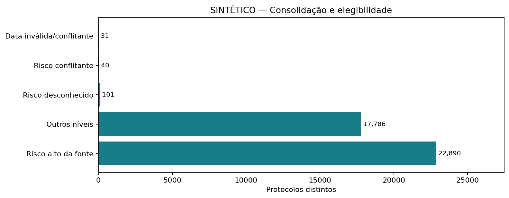
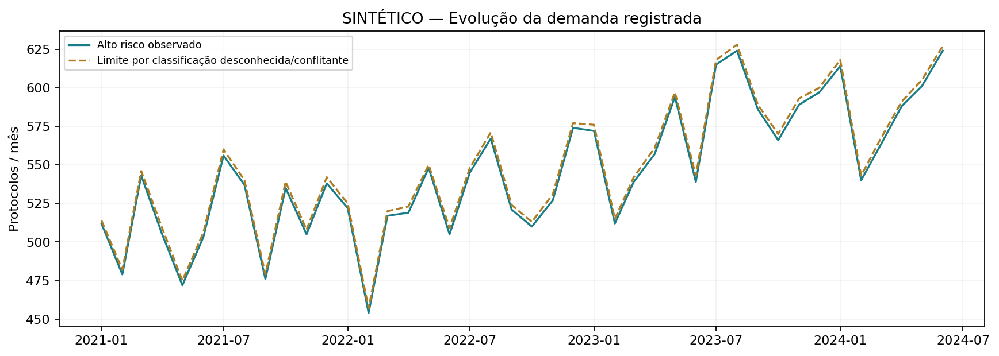
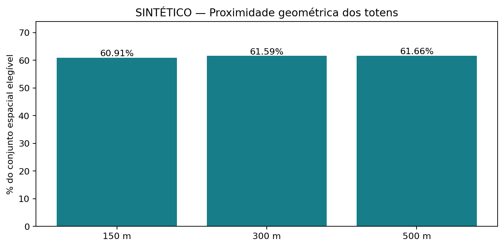
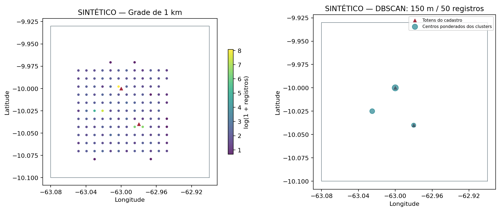
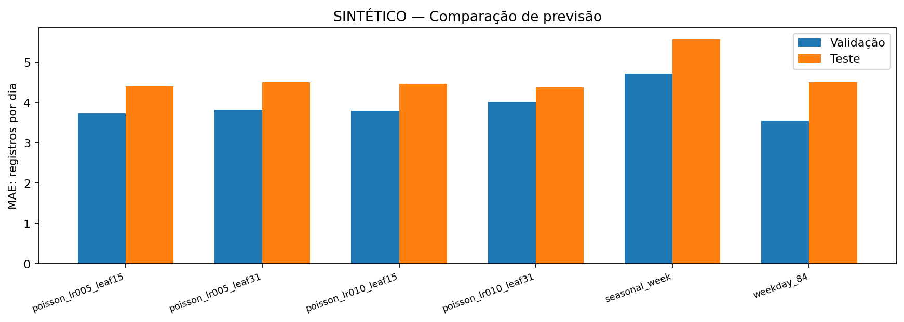
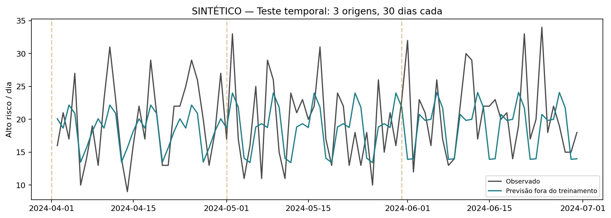
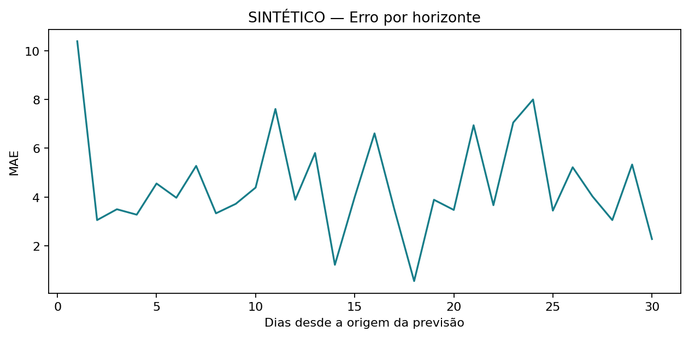

# Alto risco, cobertura territorial e previsão

**DEMONSTRAÇÃO SINTÉTICA — resultados sem interpretação operacional**

## Problema e unidade de análise

Onde se concentram registros classificados como alto risco, qual sua proximidade dos totens e com que precisão prever o volume diário? A unidade é um protocolo consolidado, classificado pelo nível da fonte (alto ou superior), com data de criação convertida para America/Porto_Velho. O alvo representa demanda registrada no acervo.

Cadastros, equipamentos e geografia desta demonstração são sintéticos; nenhuma referência real foi lida.

## Qualidade e consolidação

Foram lidas **42,454 linhas**, correspondentes a **40,848 protocolos**. As **1,606 linhas excedentes** compreendem 1,309 repetições idênticas e 297 versões com diferenças. Campos usados na análise exigem concordância entre versões; a ordem dos arquivos não determina uma versão preferida.

| Classificação de elegibilidade | Protocolos |
|---|---:|
| known_high | 22,890 |
| known_other | 17,786 |
| risk_unknown | 101 |
| risk_conflicting | 40 |
| date_invalid_or_conflicting | 31 |

| Rótulo revisado da fonte | Nível analítico |
|---|---:|
| Alto | 3 |
| Baixo | 1 |

Rótulos sem mapeamento permanecem desconhecidos; nunca são tratados como baixo risco. Protocolos sem data válida são contabilizados na exclusão global e não recebem um dia artificial no calendário.

Comparação histórica indisponível ou não aplicável à demonstração sintética.

Modo da evidência: recalculada na execução original ou sintética.

## Exploração temporal

O calendário vai de 2021-01-01 a 2024-06-30; há 0 dias fora das janelas declaradas. Meses parciais: nenhum. Zero significa zero observado no acervo. Os nomes dos arquivos não comprovam completude de extração. Alterações mensais grandes são sinalizadas somente entre meses adjacentes completos, sem exclusão automática de picos. `summary.json` registra os meses sinalizados; `daily.csv` preserva os volumes, desconhecidos e ausências.

## Geografia e proximidade

Dos 22,890 protocolos de alto risco, 58 têm coordenadas ausentes, inválidas ou conflitantes e 0 ficam fora do polígono. O denominador espacial é **22,832**. A janela de clustering vai de 2023-07-01 a 2024-06-30, com 7,087 registros.

| Raio | Dentro / denominador espacial | Proporção |
|---|---:|---:|
| 150 m | 13,908 / 22,832 | 60.9% |
| 300 m | 14,063 / 22,832 | 61.6% |
| 500 m | 14,078 / 22,832 | 61.7% |

Essa tabela usa todo o acervo espacial elegível. Na janela de 12 meses usada para clustering:

| Raio | Dentro / denominador da janela | Proporção |
|---|---:|---:|
| 150 m | 4,375 / 7,087 | 61.7% |
| 300 m | 4,422 / 7,087 | 62.4% |
| 500 m | 4,424 / 7,087 | 62.4% |

A referência de grade tem células de 1000 metros em projeção equivalente local. DBSCAN usa Haversine, coordenadas coincidentes com pesos e vizinhanças esparsas em blocos. A configuração previamente fixada (150 m, mínimo 50) encontrou **3 clusters**, com fração de ruído 0.12007901792013546. A tabela `cluster_sensitivity.csv` contém 9 configurações. A persistência entre semestres é medida pela sobreposição das células da grade configurada com pontos agrupados: Jaccard = 0.8571428571428571.

| Distância (m) | Mínimo de registros | Clusters | Ruído / volume da janela |
|---:|---:|---:|---:|
| 100 | 25 | 3 | 856 / 7,087 |
| 100 | 50 | 3 | 856 / 7,087 |
| 100 | 100 | 3 | 856 / 7,087 |
| 150 | 25 | 3 | 851 / 7,087 |
| 150 | 50 | 3 | 851 / 7,087 |
| 150 | 100 | 3 | 854 / 7,087 |
| 300 | 25 | 3 | 845 / 7,087 |
| 300 | 50 | 3 | 845 / 7,087 |
| 300 | 100 | 3 | 845 / 7,087 |

| Semestre | Registros | Clusters | Registros em ruído |
|---|---:|---:|---:|
| first_semester | 3,567 | 3 | 434 |
| second_semester | 3,520 | 3 | 420 |

As configurações e os semestres usam populações com volumes diferentes; o limiar configurado de registros pode afetar a comparação entre semestres. Baixa sobreposição e sensibilidade a parâmetros impedem tratar os clusters como áreas estáveis sem investigação adicional. As células mais frequentes e os centros ponderados para essa investigação estão nas tabelas privadas `grid.csv` e `clusters.csv`.

Proximidade é geométrica e usa o cadastro disponível de 2 pontos. As datas de operação por equipamento e outros fatores de cobertura não foram identificados. Clusters são áreas para investigar, sem estimativa de ocorrências evitadas ou efeito causal.

## Previsão retrospectiva

A série modelada vai de 2021-01-01 a 2024-06-30. O horizonte é de 30 dias. 6 blocos anteriores ao teste foram usados para validação, com treino crescente; 3 blocos formam o teste. A seleção foi congelada antes de ler os resultados do teste. Lags e médias móveis usam apenas o passado; durante cada horizonte, lags futuros usam previsões anteriores.

Foram comparados repetição semanal, média por dia da semana dos últimos 84 dias e quatro configurações de boosting Poisson, com validação aleatória interna desativada. Modelo selecionado: **weekday_84**. Seu MAE de teste é **4.502 registros/dia**, frente a 4.502 do melhor baseline no teste. Essa comparação não altera a seleção feita na validação.

Um baseline foi selecionado na validação e permaneceu competitivo no teste. A complexidade adicional dos modelos não é necessária para justificar esse resultado.

| Conjunto | Modelo | MAE | RMSE médio dos blocos | MASE médio dos blocos |
|---|---|---:|---:|---:|
| test | poisson_lr005_leaf15 | 4.402 | 5.664 | 0.944 |
| test | poisson_lr005_leaf31 | 4.504 | 5.863 | 0.966 |
| test | poisson_lr010_leaf15 | 4.465 | 5.800 | 0.958 |
| test | poisson_lr010_leaf31 | 4.375 | 5.811 | 0.938 |
| test | seasonal_week | 5.578 | 6.699 | 1.197 |
| test | weekday_84 | 4.502 | 5.548 | 0.966 |
| validation | poisson_lr005_leaf15 | 3.740 | 4.833 | 0.807 |
| validation | poisson_lr005_leaf31 | 3.828 | 4.938 | 0.826 |
| validation | poisson_lr010_leaf15 | 3.800 | 4.893 | 0.820 |
| validation | poisson_lr010_leaf31 | 4.020 | 5.167 | 0.867 |
| validation | seasonal_week | 4.711 | 5.936 | 1.016 |
| validation | weekday_84 | 3.549 | 4.431 | 0.766 |

A projeção de 2024-07-01 a 2024-07-30 é um exercício a partir do corte histórico, e não uma previsão da demanda atual. Intervalos probabilísticos não foram estimados. A disponibilidade das classificações de risco nas origens históricas não foi comprovada: a avaliação usa um snapshot consolidado retrospectivo.

## Conclusões e limites

O case demonstra consolidação auditável, análise geoespacial com sensibilidade e avaliação preditiva contra baselines. Um baseline foi selecionado na validação e permaneceu competitivo no teste. A complexidade adicional dos modelos não é necessária para justificar esse resultado. Permanecem limitações de cobertura do acervo, classificações desconhecidas, atualização de registros, localização e validade externa. O número de registros descreve a demanda observada; a interpretação sobre segurança pública exige fontes e desenho adicionais.

## Reprodução

Execução `portfolio_final_20261007`, referência Git `8f503c44f0aab8994f0820f7dbd79830623620fb` (alterações locais presentes: True), versão do case `1.0.0`. Os hashes da implementação registram o código efetivamente executado, inclusive quando ainda não commitado. O manifesto registra configuração, ambiente, hashes dos insumos e artefatos. O notebook padrão executa uma demonstração sintética com semente 42; os dados reais e os mapas detalhados ficam privados. O código versionado do notebook permanece sem outputs.

Referências metodológicas: [DBSCAN e memória](https://scikit-learn.org/stable/modules/generated/sklearn.cluster.DBSCAN.html), [features defasadas e avaliação temporal](https://scikit-learn.org/stable/auto_examples/applications/plot_time_series_lagged_features.html).
